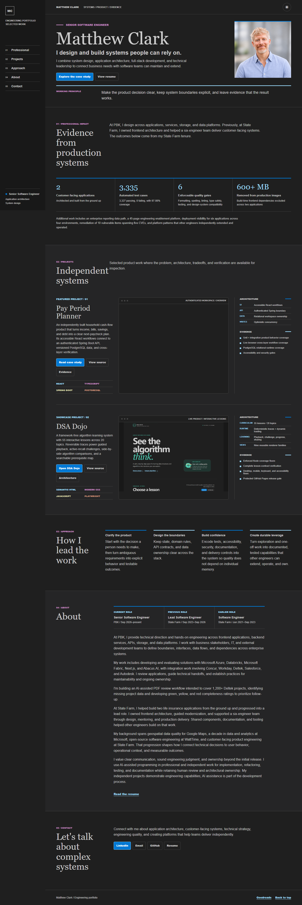

# Matthew Clark Portfolio

Public engineering portfolio for Matthew Clark. The site presents selected
work, measurable professional impact, architectural reasoning, and engineering
evidence without coupling the portfolio itself to any one product.

Pay Period Planner is the independently built flagship case study, and DSA Dojo
adds a live, framework-free algorithm learning product. A compact
professional-impact ledger, public resume, and career narrative connect that
project evidence to professional scope without turning the homepage into a
second resume or mixing private employer evidence with portfolio-project
evidence. The professional narrative emphasizes system design, application
architecture, full-stack development, enterprise integrations, and technical
leadership. PBK is the current role; the two State Farm roles remain distinct,
with production metrics attributed to that tenure. Applied generative AI work
is ongoing and distinguished from AI-assisted programming. The
internal `/work/pay-period-planner/` route turns the approved repository case
study into a product-first walkthrough with qualified engineering evidence.
Both project pages use the label "Engineering case study." The
`/work/dsa-dojo/` route explains deterministic traces, reusable renderer
contracts, source mapping, and release verification, grounded in Dojo's
repository case study. Learning outcomes remain explicitly unmeasured.

The `/resume/` route presents the approved resume in light and dark themes.
Light, Dark Modern, and Regular monochrome PDF versions each have equal Download
and View controls. `app/resume/content.json` holds the approved professional text.
The three PDF exports come from their corresponding native Google Docs with
Arial, the MC header, native links, and a two-page layout. The web page omits the
phone number and uses email and professional profile links.

## Design Direction

The site uses the Dual Canvas visual system:

- shared sticky top navigation across the homepage, resume, and case studies
- a compact keyboard-accessible mobile menu and visible active links
- case-study breadcrumbs and Product / Decisions / System / Evidence links
- neutral surfaces and VS Code blue controls in the light theme
- VS Code Dark Modern charcoal surfaces, blue actions, and syntax accents in the dark theme
- Dark Modern by default, with a light theme and saved local preference
- real product imagery rather than decorative illustrations

## Technology

- React 19
- TypeScript
- Next.js static export
- GitHub Pages delivery through the required CI workflow
- Node's built-in test runner for exported HTML checks
- Playwright smoke coverage for routes, theme persistence, responsive
  containment, anchors, screenshots, and the public resume
- ESLint and GitHub Actions verification

The Next ESLint plugin's `fast-glob` dependency is scoped to `tinyglobby@0.2.17`
to remove the unpatched `braces` dependency (GHSA-vfj7-8cjw-p6xm). The plugin
only uses its `globSync` directory-discovery API. `npm run lint` first verifies
that API through Next's own root-discovery utility, including directory-only
matching, brace patterns, multiple roots, Windows separators, and missing paths.
Remove the override when the upstream plugin no longer depends on the vulnerable
chain; review this assertion when upgrading the plugin.

The first version intentionally has no authentication, database, contact form,
analytics, or chatbot. Those features should be added only when they serve a
clear portfolio need.

## Local Development

Requires Node.js 24.22.1 LTS or 26.12.1 (Current). `.node-version` selects the recommended LTS release.

```bash
npm ci
npm run dev
```

## Verification

```bash
npm run lint
npm test
npm run test:browser
```

`npm test` creates a static production export and verifies its content,
metadata, public links, theme support, GitHub Pages asset paths, and absence of
server-only runtime surfaces. `npm run test:browser` starts the site on an
isolated local port and exercises the portfolio-critical Chromium workflows.

## Deployment

Pull requests run the same static export checks without publishing. A passing
push to `main` uploads the generated `out/` directory and deploys it to
[GitHub Pages](https://everdein.github.io/portfolio/). The portfolio contains no
server process, runtime secrets, authentication, or persistence.

## Content Sources

The public resume at `public/matthew-clark-resume.pdf` is the user-approved
Google Docs PDF export. The portfolio and GitHub profile link to the resume
page, which offers light, dark, and regular PDFs.
Replace both with approved exports when the resume changes;
preserve the exported typography, layout, links, and content rather than
regenerating it from a separate resume builder. Inspect both PDF pages before
publishing and verify that the deployed file matches the approved export.
Original historical resume files are not overwritten.

Run `node scripts/build-social-preview.mjs` to regenerate `public/og.png` with
the repository's Playwright dependency. Inspect the image and update the cache
version in `app/layout.tsx` when changing the published card.
Set `PORTFOLIO_CHROMIUM_PATH` to an existing Chromium executable when using a
locally managed browser; the preview builder and browser tests both accept it.

- [Pay Period Planner](https://github.com/everdein/pay-period-planner)
- [Pay Period Planner case study](https://github.com/everdein/pay-period-planner/blob/main/docs/portfolio-case-study.md)
- [Pay Period Planner engineering evidence](https://github.com/everdein/pay-period-planner/blob/main/docs/engineering-evidence.md)
- [DSA Dojo live product](https://everdein.github.io/dsa-dojo/)
- [DSA Dojo source](https://github.com/everdein/dsa-dojo)
- [DSA Dojo architecture](https://github.com/everdein/dsa-dojo/blob/main/docs/studio-architecture.md)
- [GitHub profile](https://github.com/everdein)
- [Goodreads](https://www.goodreads.com/everdein)

## Dark theme preview



## Visual identity

See [the shared visual system](docs/visual-system.md) for the font pairing, Dark Modern palette and screenshot policy.

## Dependency maintenance

See [dependency and runtime maintenance](docs/dependency-maintenance.md) for the current package versions, runtime baseline, upgrade constraints, and verification procedure. Last reviewed October 24, 2026.
